<p align="center">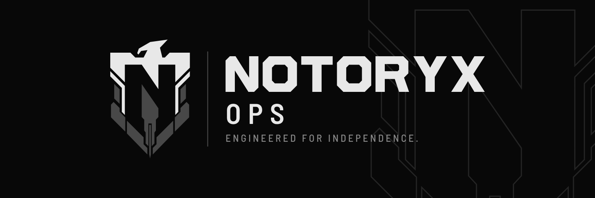</p>

# NOTORYX Ops

Network dashboard and infrastructure station for MeshCore.

NOTORYX Ops runs on a Raspberry Pi, a Mac (as its own app window) or in Docker, next to a MeshCore companion radio. Open the dashboard in any browser on your network.

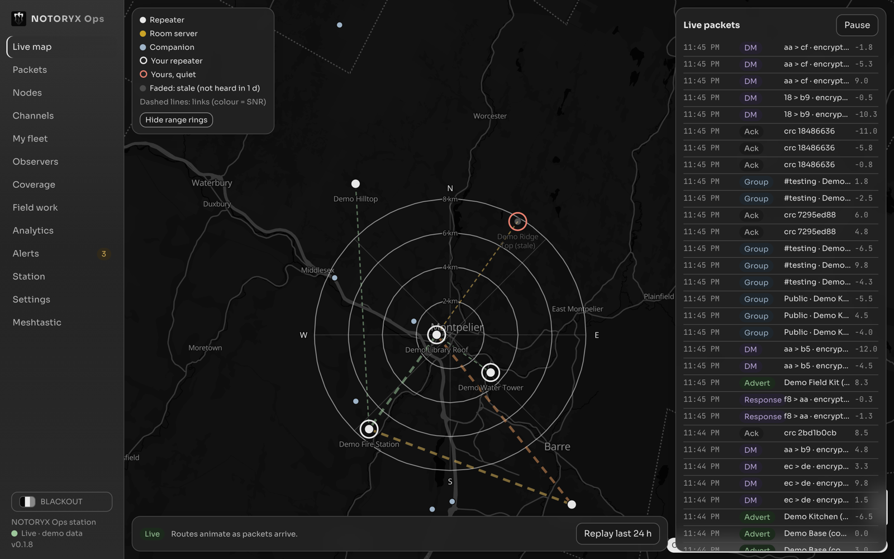

## What it does

- **Live map:** every packet heard by the station radio and by observers on MQTT brokers, drawn as routes on the map as it arrives, with a 24-hour replay, range rings around your station, faded stale nodes and an ignore list for noisy ones.
- **Packets, nodes and observers:** a packet feed with a decoder, a node list with type, prefix, last heard, best SNR and position, and the health of each observer.
- **Channels and SARNEG:** messages on every channel the station has a key for. Enter your team's SARNEG code word (or paste the share text from the NOTORYX phone apps) and click any `[SARNEG]` message to read its numbers. The word stays in that browser and is never sent to the station. Ops decodes only; it doesn't send SARNEG. SARNEG is not encryption.
- **Fleet:** logs in to the repeaters you own and tracks battery, noise floor, airtime, uptime, neighbours and firmware over time. Alerts go to Discord or a webhook when a repeater goes quiet, its battery is low or falling, its firmware is behind, or two repeaters share a prefix. Bulk settings show the current values before changing one setting on several repeaters.
- **Coverage and planning:** measured coverage hexes, plus coverage worked out from real elevation (Copernicus DEM), link profiles with line of sight, Fresnel zone and a link budget, a high-ground finder and relay planning that shows the area a new relay would add. Predictions can be calibrated against links the station has heard.
- **Field work:** hazard reports (flooded road, fallen tree, power line down and more) sent and received as plain channel messages any MeshCore app can read, teams on their own private channels with position tracks, and an offline survey mode for phones that saves each spot and uploads it later. CSV and GPX survey imports.
- **Analytics:** packet counts, a 7-day activity grid, packet types, busiest relays, most active nodes and a one-byte prefix clash check.
- **Accounts and integrations:** optional sign-in with viewer, operator and admin roles (the admin token keeps working for scripts), GeoJSON and GPX exports, Prometheus metrics at `/metrics`, a read-only public map at `/public` with rounded positions (off by default), Home Assistant sensors over MQTT discovery, and a PostgreSQL archive (`pip install "notoryx-ops[postgres]"`).
- **Looks:** BLACKOUT (the default), Aurora, Ember, Nebula, Graphite and Sandstone. The map, node, route, signal and chart colours change with the look.
- **Meshtastic add-on (optional, GPL-3.0):** remote admin of Meshtastic nodes over the air, settings templates with compliance checks, and a Meshtastic⇄MeshCore channel bridge. See [the add-on](addons/meshtastic/).

## Screenshots

All screenshots are from demo mode with made-up nodes.

| | |
|---|---|
| 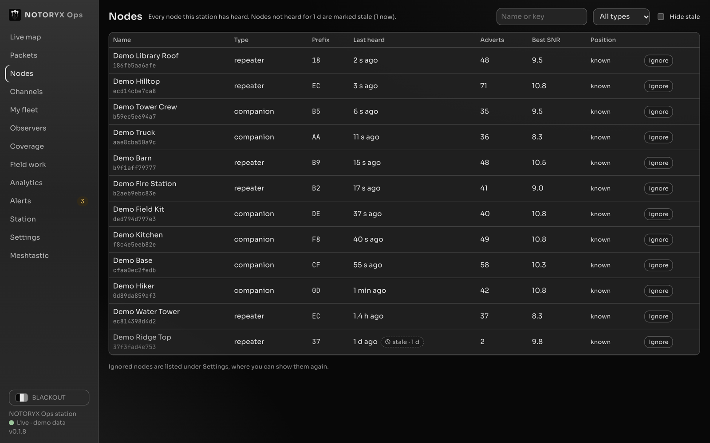 **Nodes** with type, prefix, last heard and best SNR | 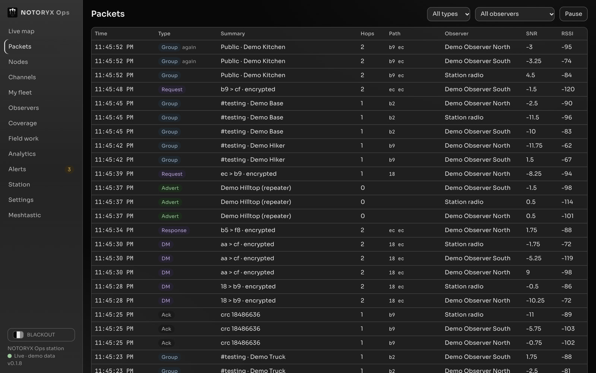 **Packets** from every observer |
| 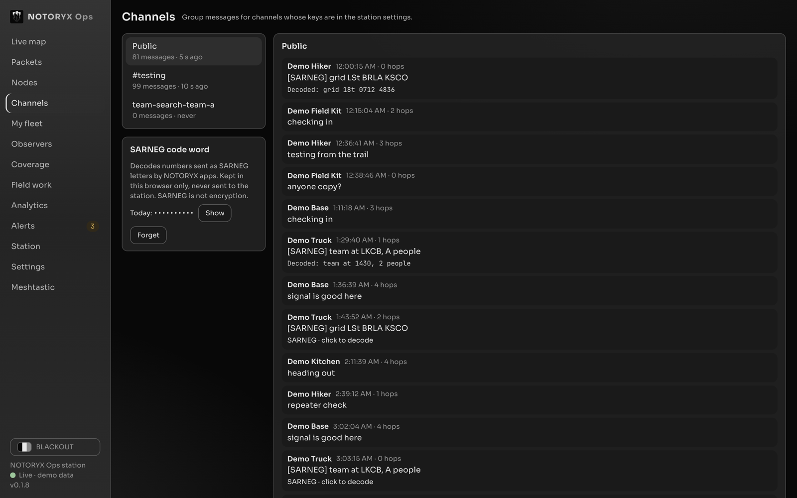 **Channels** with SARNEG messages decoded | 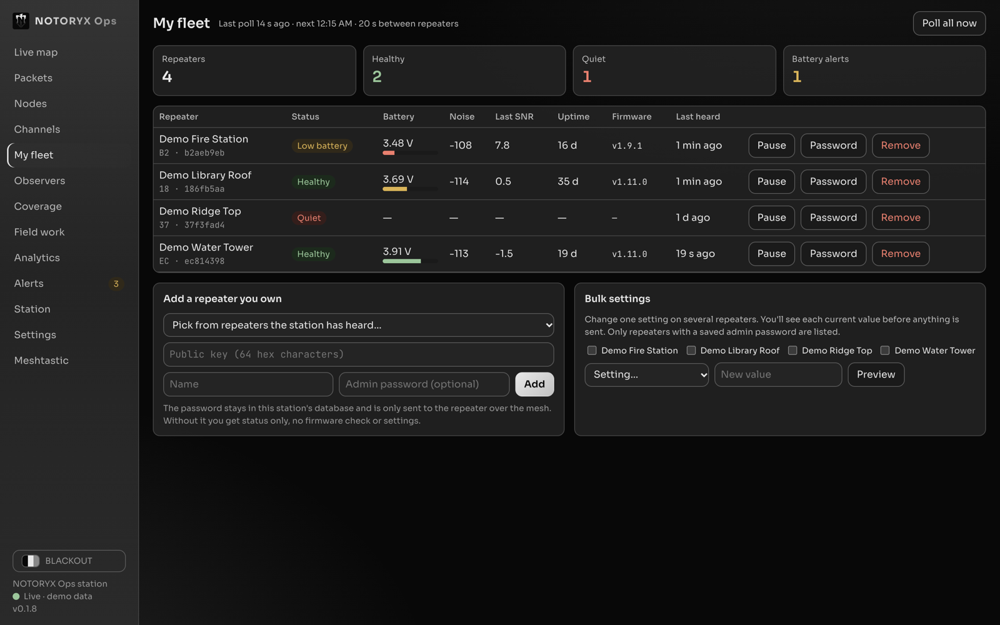 **My fleet**: battery, noise, SNR, uptime and firmware |
| 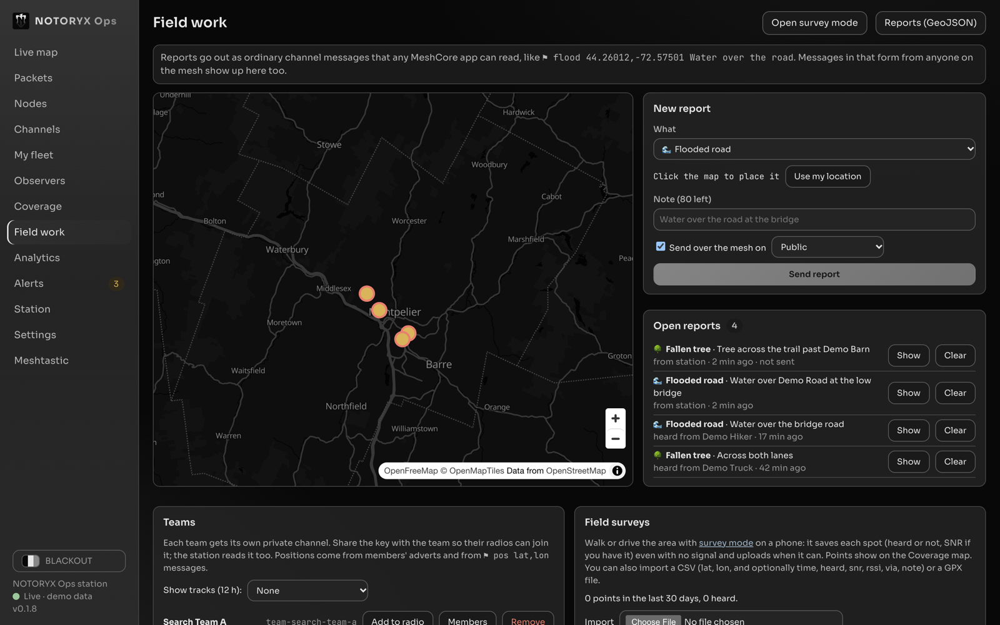 **Field work**: hazard reports on the map, teams and surveys | 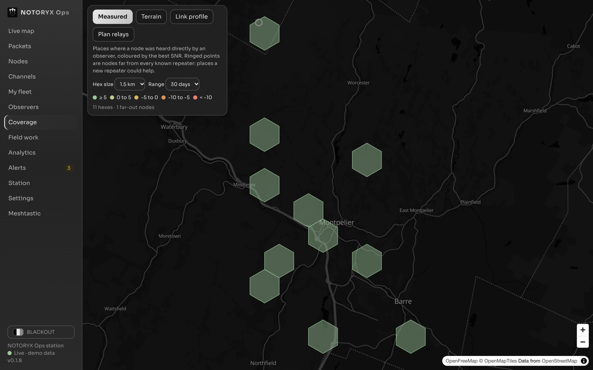 **Coverage** from measured links, terrain and relay planning |
| 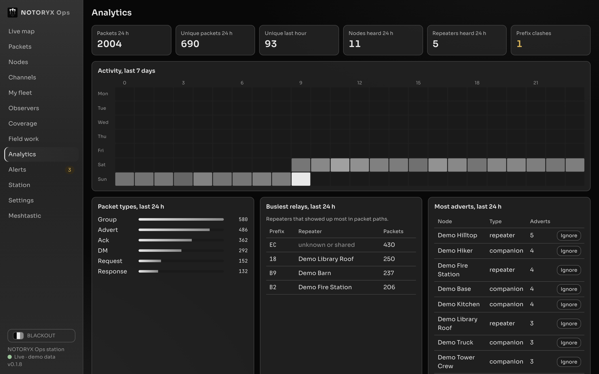 **Analytics** for the last 24 hours and 7 days | 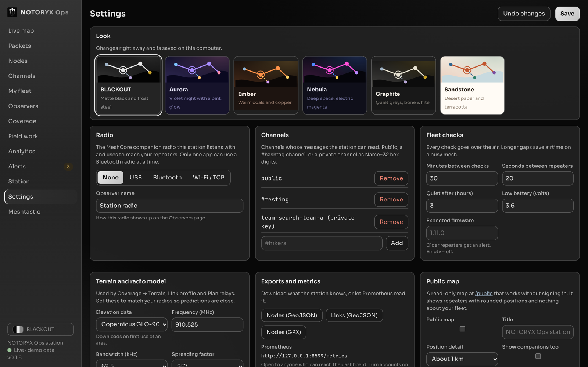 **Settings** with the six looks |
| 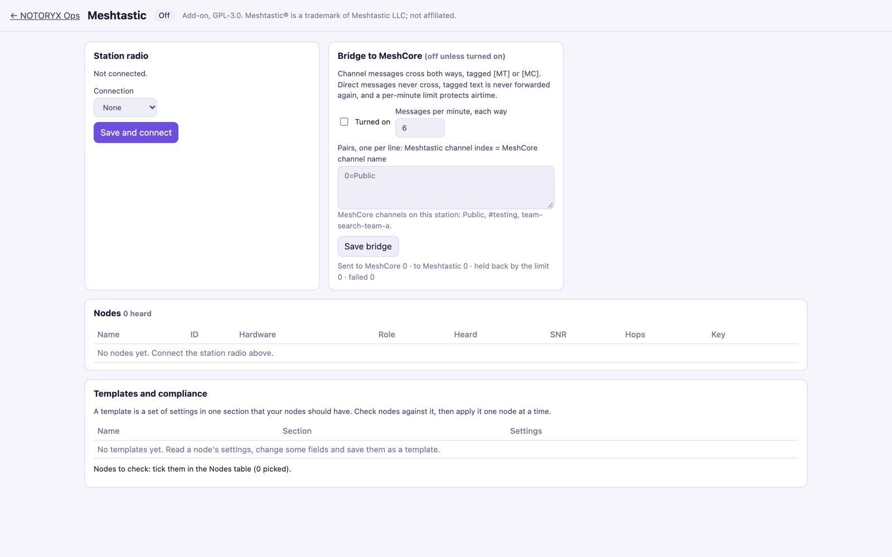 **Meshtastic add-on** page (radio not connected) | |

## Status

Test builds. The latest is **0.1.8 test 9** (21 November 2026, with SARNEG decoding) and the Meshtastic add-on 0.1.1, from [NOTORYX-Ops-Releases](https://github.com/TheLogsAreScreaming/NOTORYX-Ops-Releases/releases). The BLACKOUT look and icons are merged and arrive in the next build.

Checked on a real station with a MeshCore radio: live packets, the map, stale nodes, the ignore list, range rings, and hazard reports on a test channel. The Meshtastic add-on was checked with two Meshtastic radios: remote reads and writes, reboot, and the bridge both ways. Not checked on hardware yet: teams on the radio, add-on template apply, and the fleet tools on real repeaters. See [docs/USER_GUIDE.md](docs/USER_GUIDE.md) and [docs/PLAN.md](docs/PLAN.md).

## Try it without a radio

```bash
python3 -m venv .venv && .venv/bin/pip install -e ".[dev]"
(cd web && npm ci && npm run build)
.venv/bin/notoryx-ops run --demo --open
```

Demo mode fills the dashboard with made-up traffic and a pretend fleet. Nothing is sent over the air.

## Layout

| Path | What it is |
|---|---|
| `src/notoryx_ops/decoder.py` | Packet decoder (written from the public packet format) |
| `src/notoryx_ops/channels.py` | Channel keys and group message decryption |
| `src/notoryx_ops/radio.py` | Companion radio link (USB, Bluetooth, TCP) |
| `src/notoryx_ops/mqtt_ingest.py` | Observer packets from MQTT brokers |
| `src/notoryx_ops/fleet.py` | Repeater polling, history, bulk settings |
| `src/notoryx_ops/alerts.py` | Alert rules, Discord and webhook delivery |
| `src/notoryx_ops/analytics.py` | Overview, heatmap, prefixes, links, coverage |
| `src/notoryx_ops/terrain.py` | Elevation tiles, radio path model, coverage, high points, relay planning |
| `src/notoryx_ops/planning.py` | Terrain API and calibration from measured links |
| `src/notoryx_ops/field.py` | Field reports, teams, position tracks, surveys |
| `src/notoryx_ops/addons.py` | Loader for optional add-on packages |
| `addons/meshtastic/` | Meshtastic add-on (GPL-3.0, its own package) |
| `src/notoryx_ops/auth.py` | Accounts, roles and sign-in sessions |
| `src/notoryx_ops/integrations.py` | Exports, metrics, public map, Home Assistant, PostgreSQL |
| `src/notoryx_ops/server.py` | Web API and live updates |
| `web/` | Dashboard (React, MapLibre, uPlot) |
| `web/src/themes.ts` | The looks (BLACKOUT is the default) |
| `web/src/sarneg.ts` | SARNEG decoding, same format as the NOTORYX phone apps |
| `packaging/` | Docker and Raspberry Pi installer |
| `macos/` | Native Mac app (Swift window around the dashboard; Quit stops the station) |
| `docs/images/` | README banner and screenshots |

## Development

```bash
.venv/bin/notoryx-ops where   # where the config and data live
.venv/bin/pytest -q
.venv/bin/ruff check src tests
cd web && npm run dev     # dashboard on :5173, proxied to a station on :8484
```

## Downloads

Builds are published on the NOTORYX-Ops-Releases repo, not here. The **Release build** workflow makes the wheel, Raspberry Pi bundle, Docker bundle, Mac app and `SHA256SUMS`.

## Clean-room rule

All code here is written from scratch. Ideas may come from other mesh tools, but no code is copied from them, and they are not named in this repo. The MeshCore Python library (MIT) is used as a dependency for the radio link.

## License

MIT. See [LICENSE](LICENSE).

**Add-ons** are separate packages with their own licence. The optional [Meshtastic add-on](addons/meshtastic/) (remote admin, templates and compliance checks, and a Meshtastic⇄MeshCore bridge) is GPL-3.0 because it uses the Meshtastic Python library; NOTORYX Ops works without it, and its own code stays MIT.

Elevation data: Copernicus DEM, © DLR e.V. 2010-2014 and © Airbus Defence and Space GmbH 2014-2018, provided under COPERNICUS by the European Union and ESA. Tiles are downloaded on first use of an area; nothing is bundled.

---
🛠️ AI-assisted: built with Anthropic's Claude, directed and reviewed by [BaconDisk22](https://github.com/BaconDisk22). Checked by automated tests and CI; review before relying on it.
